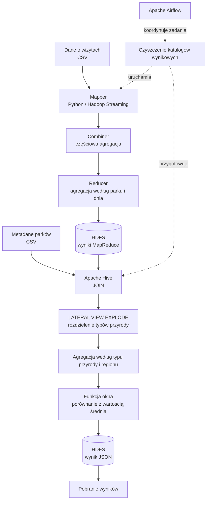

# Analiza odwiedzin parków - Hadoop MapReduce, Hive i Airflow

Projekt przedstawia potok przetwarzania danych o wizytach w parkach. W pierwszym etapie dane są agregowane z użyciem **Apache Hadoop MapReduce Streaming** i skryptów w **Pythonie**. Następnie wyniki są łączone z metadanymi parków i analizowane w **Apache Hive**. Całość może być uruchamiana i koordynowana przez **Apache Airflow**.

## Przepływ przetwarzania

Diagram przedstawia kolejność operacji oraz rolę poszczególnych narzędzi:



## 1. Agregacja danych - Hadoop MapReduce

Skrypty MapReduce przetwarzają rekordy wizyt i grupują je według identyfikatora parku oraz daty wejścia (`entry_time`).

- **Mapper** odczytuje pliki CSV, wyznacza dzień wizyty i emituje identyfikator parku, datę, wielkość grupy oraz licznik rekordu.
- **Combiner** wykonuje częściowe sumowanie liczby osób i liczby wizyt przed przekazaniem danych do Reducera.
- **Reducer** łączy częściowe wyniki i wyznacza dzienne statystyki dla każdego parku.

Wynik zawiera pola:

| Pole | Znaczenie |
|---|---|
| `park_id` | identyfikator parku |
| `date` | dzień wizyty |
| `visits_count` | liczba wizyt |
| `avg_group_size` | średnia wielkość grupy dla danego dnia i parku |
| `sum_group_size` | suma wielkości grup, potrzebna do dalszego obliczenia średniej ważonej |

Do uruchomienia skryptów w klastrze wykorzystywany jest Hadoop Streaming.

## 2. Analiza danych - Apache Hive

Hive łączy dzienne wyniki MapReduce z tabelą zawierającą metadane parków. Następnie:

1. Rozdziela wielowartościowe pole `nature_types` przy użyciu `LATERAL VIEW EXPLODE`.
2. Grupuje dane według typu przyrody i regionu.
3. Oblicza łączną liczbę wizyt oraz średnią wielkość grupy. Średnia jest liczona na podstawie sum i liczności, dzięki czemu zachowuje wagi poszczególnych dni.
4. Wykorzystuje funkcję okna do porównania liczby wizyt w regionie ze średnią dla danego typu przyrody.

Wynik końcowy jest zapisywany w formacie JSON w HDFS i zawiera:

- `nature_type` - typ przyrody,
- `region` - region,
- `total_visits` - łączną liczbę wizyt,
- `avg_group_size` - średnią wielkość grupy,
- `visits_deviation` - różnicę między liczbą wizyt w regionie a średnią dla danego typu przyrody.

## 3. Orkiestracja - Apache Airflow

DAG w Airflow koordynuje kolejne kroki potoku:

1. Usunięcie poprzednich katalogów wynikowych w HDFS.
2. Uruchomienie zadania Hadoop MapReduce.
3. Uruchomienie zapytania Hive.
4. Pobranie i wyświetlenie fragmentu końcowego pliku JSON.

Ścieżki wejściowe i wyjściowe są parametryzowane w konfiguracji DAG-a, dzięki czemu można je dostosować do środowiska uruchomieniowego.

## Wykorzystane technologie

- **Python 3** - implementacja Mapper, Combiner i Reducer.
- **Apache Hadoop** - HDFS oraz MapReduce Streaming.
- **Apache Hive** - tabele zewnętrzne, JOIN, agregacje, `LATERAL VIEW EXPLODE` i funkcje okna.
- **Apache Airflow** - orkiestracja zadań przy użyciu `BashOperator`.
- **Bash** - skrypty uruchomieniowe.
- **CSV i JSON** - formaty danych wejściowych i wynikowych.

## Struktura repozytorium

```text
.
├── airflow/
│   └── dags/
│       └── parks_visits_dag.py
├── input/
│   └── sample/
│       ├── datasource1/
│       │   └── visits_sample.csv
│       └── datasource4/
│           └── parks.csv
├── project_files/
│   ├── mapper.py
│   ├── combiner.py
│   ├── reducer.py
│   ├── hive.hql
│   ├── run_mr.sh
│   └── run_hive.sh
└── tests/
    ├── fixtures/
    │   └── visits.csv
    └── test_mapreduce.py
```

## Dane wejściowe

Dane źródłowe zostały wygenerowane syntetycznie przy użyciu [Datafaker](https://www.datafaker.net/). Repozytorium zawiera niewielką próbkę danych o wizytach oraz tabelę wymiaru parków, aby można było zapoznać się ze strukturą danych i logiką przetwarzania. Pełny zbiór danych, przekraczający 100 MB, nie jest częścią repozytorium.

Zbiór wizyt (`datasource1`) zawiera pola:

- `visit_id`,
- `park_id`,
- `visitor_id`,
- `entry_time`,
- `exit_time`,
- `group_size`,
- `activity`.

Zbiór metadanych parków (`datasource4`) zawiera m.in. `park_id`, `region` oraz pole `nature_types`, w którym typy przyrody są rozdzielone średnikami.

## Wymagania środowiskowe

Do uruchomienia pełnego, rozproszonego potoku potrzebne są:

- Apache Hadoop z HDFS i poleceniem `mapred streaming`,
- Apache Hive oraz HiveServer2/Beeline,
- biblioteki OpenCSV i Hive HCatalog dostępne dla Hive,
- Apache Airflow z dostawcą standardowych operatorów,
- Python 3 dostępny na węzłach wykonujących zadania Hadoop.

DAG korzysta z interfejsu `airflow.sdk.Param` dostępnego w Airflow 3. Hadoop, Hive i Airflow muszą być wcześniej skonfigurowane w środowisku. Repozytorium nie zawiera tych usług ani ich konfiguracji infrastrukturalnej.

## Uruchomienie

Poniższe polecenia zakładają, że Hadoop, HDFS i Hive są już uruchomione, a polecenia `hadoop`, `mapred` oraz `beeline` są dostępne w systemie.

### 1. Przygotowanie danych w HDFS

Utwórz katalogi i skopiuj przykładowe pliki:

```bash
hadoop fs -mkdir -p /project1/input/datasource1 /project1/input/datasource4
hadoop fs -put input/sample/datasource1/visits_sample.csv /project1/input/datasource1/
hadoop fs -put input/sample/datasource4/parks.csv /project1/input/datasource4/
```

### 2. Uruchomienie MapReduce

```bash
bash project_files/run_mr.sh /project1/input/datasource1 /project1/output_mr3
```

### 3. Uruchomienie Hive

Po zakończeniu zadania MapReduce uruchom agregację w Hive:

```bash
bash project_files/run_hive.sh \
  /project1/output_mr3 \
  /project1/input/datasource4 \
  /project1/output6
```

Wynik zostanie zapisany w skonfigurowanym katalogu HDFS w formacie JSON.

### 4. Uruchomienie przez Airflow

Umieść plik `airflow/dags/parks_visits_dag.py` w katalogu DAG-ów Airflow. Katalog `project_files/` należy umieścić obok niego, tak aby domyślna ścieżka `/opt/airflow/dags/project_files` wskazywała na skrypty i plik HiveQL.

Domyślne parametry DAG-a:

| Parametr | Domyślna wartość |
|---|---|
| `project_files_dir` | `/opt/airflow/dags/project_files` |
| `input_dir` | `/project1/input` |
| `output_mr_dir` | `/project1/output_mr3` |
| `output_dir` | `/project1/output6` |

W razie potrzeby można zmienić wartości parametrów przy uruchamianiu DAG-a. Worker Airflow musi mieć dostęp do poleceń Hadoop i Beeline oraz do usług HDFS i Hive.

## Testy

Logikę Mapper, Combiner i Reducer można sprawdzić lokalnie, bez uruchamiania klastra Hadoop i Hive:

```bash
python -m unittest discover -s tests -v
```

Test uruchamia trzy skrypty na niewielkim pliku fixture i sprawdza dzienne agregaty wizyt. Nie jest to test integracyjny klastra: nie uruchamia Hadoop Streaming ani zapytania Hive.

## Zakres repozytorium

Repozytorium zawiera kod przetwarzania, DAG Airflow, przykładowe dane i test logiki MapReduce. Nie zawiera pełnego zbioru źródłowego (ponad 100 MB), materiałów kursowych, kryteriów oceniania, konfiguracji IDE, plików tymczasowych ani wygenerowanych wyników pośrednich.
